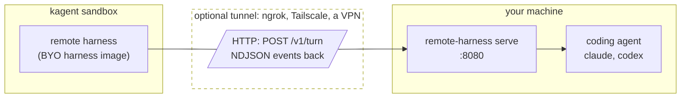

# kagent-remote-harness

> [!CAUTION]
> **Early alpha. Use at your own risk.** It gives an agent in a cluster code
> execution on your machine; read [Security](#security) before you start.

Run a [kagent](https://kagent.dev) agent's turns on your own machine, with
your local coding agent, like Claude Code or Codex. Like Claude Code Remote
Control, but for kagent: you talk to the agent in kagent, and your machine
does the work.

## How it works

**Two programs speak a small HTTP protocol: the harness in kagent sends each
turn, and the runner on your machine runs it.**



| Part | What it is |
| --- | --- |
| Harness image `ghcr.io/airohq/kagent-remote-harness` | A kagent `byo` harness. It POSTs each turn to the runner's URL and turns the runner's events into kagent's |
| CLI `remote-harness serve` | Serves the protocol on a local port and runs your coding agent's CLI for each turn |
| Go package `runner` | The runner as an `http.Handler`, for programs that bring their own transport |
| Go package `wire` | The protocol between them; see [Protocol](docs/protocol.md) |

**The runner listens on a port, checks each request's token, and passes the
turn to your coding agent.** A request without the right token gets `401` and
never reaches the coding agent, so the token is what keeps others from
running commands on your machine. The harness reaches the port directly, or
through a tunnel such as ngrok when your machine has no address the cluster
can reach. A program with its own transport can embed the `runner` package
instead of the CLI.

**kagent keeps the conversation; your machine keeps the work.** kagent stores
the messages. The machine keeps the working copy and the coding agent's own
session, such as a Claude Code session or a Codex thread, which the next turn
resumes.

## Prerequisites

| Need | For |
| --- | --- |
| A kagent cluster, with `EgressPolicy` support | The agent and its harness |
| A tunnel (optional), such as [ngrok](https://ngrok.com) with a static domain | Lets the cluster reach your machine without an open port |
| A sandbox (optional), such as [Docker](https://www.docker.com) | Limits what a turn reaches on your machine |
| Your coding agent's credentials, such as a Claude Code token | The coding agent signs in with them |

**Both options are optional, and both are recommended.** Without them, you
secure the network and the sandbox some other way; see [Security](#security).

## Get started: Claude Code + ngrok tunnel + Docker sandbox

You need:

- [Docker](https://docs.docker.com/get-docker/)
- [ngrok](https://ngrok.com/download), signed in (`ngrok config add-authtoken`),
  with a [static domain](https://dashboard.ngrok.com/domains)
- [Claude Code](https://code.claude.com/docs/en/setup) with a Claude
  subscription, for `claude setup-token`
- `kubectl` and the [kagent CLI](https://kagent.dev/docs), with access to a
  namespace in your kagent cluster

The steps start the runner in a container on your machine, expose it to the
cluster through ngrok, and create a kagent agent that sends its turns there.

1. **Copy the example `.env`**, readable only by you:

   ```sh
   curl -fsSL https://raw.githubusercontent.com/airohq/kagent-remote-harness/main/.env.example -o .env
   chmod 600 .env
   ```

2. **Set the two tokens in `.env`:**

   | Variable | Value |
   | --- | --- |
   | `REMOTE_HARNESS_TOKEN` | The runner's token, which kagent sends and the runner checks: the output of `openssl rand -hex 32` |
   | `CLAUDE_CODE_OAUTH_TOKEN` | Your Claude Code token: run `claude setup-token`, and paste the token it prints. It uses your Claude subscription |

3. **Start the runner in a hardened container**, on a port only your machine
   reaches. This runs Claude Code; for Codex, see [Harnesses](#harnesses).

   ```sh
   docker run --rm -it -p 127.0.0.1:8080:8080 \
     --read-only --tmpfs /tmp --cap-drop ALL --security-opt no-new-privileges \
     --memory 4g --cpus 2 --pids-limit 512 \
     --env-file .env \
     -v remote-harness:/work \
     ghcr.io/airohq/kagent-remote-harness/runner \
     serve --harness claude --claude-permission-mode acceptEdits
   ```

   The flags on the second and third lines harden the container;
   [The execution boundary](docs/security.md#the-execution-boundary) says
   what each does.

4. **Expose it with ngrok:**

   ```sh
   ngrok http 127.0.0.1:8080 --url https://<your-domain>.ngrok-free.app
   ```

   Check it: `curl https://<your-domain>.ngrok-free.app/v1/info` answers
   `401` without the token.

5. **Create the agent in kagent.** The EgressPolicy lets the sandbox reach
   only your ngrok URL, and its gateway adds the token, so the token never
   enters the sandbox. The Secret gets only the runner's token from `.env`,
   not your Claude Code token.

   ```sh
   kubectl create secret generic my-laptop-runner -n <namespace> \
     --from-env-file=<(grep '^REMOTE_HARNESS_TOKEN=' .env)
   ```

   ```yaml
   apiVersion: api.kagent.dev/v1alpha3
   kind: EgressPolicy
   metadata: {name: my-laptop, namespace: <namespace>}
   spec:
     destinations:
       - origin: https://<your-domain>.ngrok-free.app
         authentication:
           header: Authorization
           prefix: "Bearer "
           secretKeyRef: {name: my-laptop-runner, key: REMOTE_HARNESS_TOKEN}
   ---
   apiVersion: api.kagent.dev/v1alpha3
   kind: Harness
   metadata: {name: my-laptop, namespace: <namespace>}
   spec:
     byo: {}
     workload:
       image: ghcr.io/airohq/kagent-remote-harness:<version>
       command: ["/harness"]
     env:
       - {name: REMOTE_HARNESS_URL, value: https://<your-domain>.ngrok-free.app}
     substrate:
       workerPoolRef: {name: <worker pool>}
   ---
   apiVersion: api.kagent.dev/v1alpha3
   kind: Agent
   metadata: {name: my-laptop, namespace: <namespace>}
   spec:
     harnessRef: {name: my-laptop}
     egressPolicyRefs: [{name: my-laptop}]
     template:
       inline:
         description: The coding agent on my laptop.
         systemPrompt: You work in the repository in your working directory.
   ```

   Without a `modelConfig`, the coding agent uses its default model; see
   [Choose the model](#choose-the-model).

6. **Call the agent** with the kagent CLI, through the kagent controller:

   ```sh
   kubectl port-forward -n kagent svc/kagent-controller 8083:8083
   ```

   ```sh
   kagent invoke -n <namespace> --agent my-laptop --stream \
     --task "List the files in your working directory"
   ```

   The runner's log shows the turn, and the answer streams back. You can
   also chat with the agent in the kagent UI (`kagent dashboard`).

## Harnesses

**The runner runs one coding agent CLI per turn, in `--workdir`, with the
prompt on stdin.** `--harness` picks the CLI, and has no default: `serve`
refuses to start without it. These are the exact commands, so you know what
runs on your machine:

| `--harness` | New conversation | Later turns | Signs in with |
| --- | --- | --- | --- |
| `claude` | `claude -p --output-format stream-json --verbose --permission-mode <mode> [--model <model>] [--append-system-prompt <instructions>] [<harness args>]` | The same, plus `--resume <session>` | `CLAUDE_CODE_OAUTH_TOKEN` or `ANTHROPIC_API_KEY` |
| `codex` | `codex exec --json --skip-git-repo-check -C <workdir> [-m <model>] --sandbox <sandbox> [<harness args>] -`, with the instructions before the prompt | `codex exec --json --skip-git-repo-check -C <workdir> [-m <model>] -c sandbox_mode="<sandbox>" [<harness args>] resume <thread> -` | `OPENAI_API_KEY`, or your Codex login |

- **`<model>` comes from the Agent's `modelConfig`**, and is left out when
  the Agent has none, so the CLI uses its own default.
- **`<instructions>` is the Agent's system prompt.** Codex has no flag for
  one, so it gets the instructions at the start of a new conversation.
- **`<mode>` and `<sandbox>` have no default.** You choose what the coding
  agent does without asking, with `--claude-permission-mode` or
  `--codex-sandbox`, because nothing can ask you. See
  [Approvals](docs/security.md#approvals).
- **`<harness args>` are your own flags**, from `--harness-arg`, such as
  `--harness-arg=--disallowedTools=Bash` to take a tool away.
- **The coding agent gets the runner's environment without the runner's
  token**, so a turn can't read the token.

### Choose the model

**Give the Agent a ModelConfig with the model's name.** The harness passes it
to the CLI. It needs no API key, since the model runs on your machine with
the CLI's own login.

```yaml
apiVersion: api.kagent.dev/v1alpha3
kind: ModelConfig
metadata: {name: opus, namespace: <namespace>}
spec:
  provider: Anthropic
  model: opus            # claude --model opus
---
apiVersion: api.kagent.dev/v1alpha3
kind: Agent
metadata: {name: my-laptop, namespace: <namespace>}
spec:
  template:
    inline:
      modelConfig: {name: opus}
  # harnessRef and egressPolicyRefs as above
```

### Flags and environment

| `remote-harness serve` | Default | Meaning |
| --- | --- | --- |
| `--listen` | `:8080` | The address to listen on |
| `--workdir` | `.`; `/work/workspace` in the image | The directory the coding agent works in |
| `--state-dir` | None; `/work/state` in the image | Keeps the machine's name across restarts |
| `--harness` | Required | `claude` or `codex` |
| `--machine` | The name kept in `--state-dir`, else the host name | The machine's name, which ties a conversation to it. A container gets a new host name on every start, so the image keeps the first one on the volume |
| `--claude-permission-mode` | Required with `claude` | Claude Code's `--permission-mode`, such as `acceptEdits` |
| `--codex-sandbox` | Required with `codex` | Codex's `--sandbox`, such as `workspace-write` |
| `--harness-arg` | None | A flag to add to the CLI's command; repeatable |
| `--token-file` | | The file holding the token every request must carry |
| `REMOTE_HARNESS_TOKEN` | | The token, when there is no `--token-file`. One of the two is required |
| `--turn-timeout` | `30m` | How long one turn may run before the runner stops it |
| `--log-content` | `false` | Log prompts and the coding agent's output. Off, the log has only turn IDs, timing and results |

| Harness environment | Default | Meaning |
| --- | --- | --- |
| `REMOTE_HARNESS_URL` | Required | The runner's URL |
| `REMOTE_HARNESS_WAIT` | `2m` | How long a turn waits for an offline or busy runner |

## Security

**This bypasses kagent's sandboxing, so securing the sandbox and the network
is your responsibility.** Every turn runs your coding agent with the access
of the process it runs in: your files, your SSH keys, your logins.

- **Sandbox: run the runner in a hardened container**, as in
  [Get started](#get-started-claude-code--ngrok-tunnel--docker-sandbox):
  non-root, no capabilities, a read-only root, resource limits, and only a
  working copy and narrow credentials. The
  container is defense in depth, not a boundary for hostile input.
- **Network: reach the runner through a tunnel**, such as ngrok, to a port
  published on `127.0.0.1` only.
- **Trust what triggers the agent.** Anyone who can message the agent, or who
  gets the runner's token, can make it run commands. For untrusted input, take
  tools away or use a disposable environment.
- **The token keeps others out.** Keep it in `.env` and in a Secret only the
  EgressPolicy reads.

[Security](docs/security.md) covers each of these in detail.

## Limitations

> [!NOTE]
> **Run one kagent agent and one runner as a pair, one pair at a time.** A
> runner serves one agent's conversations, one turn at a time, and one URL
> reaches one runner.

- **A conversation stays on the machine that started it.** The harness
  fails a turn that reaches another machine rather than starting over without
  the work.
- **One turn at a time.** A second turn waits until the first ends.
- **A turn waits 2 minutes for an offline runner**, such as a laptop that is
  asleep, then fails with a message that the runner is offline.
- **A turn runs at most `--turn-timeout`** (default 30 minutes); then the
  runner stops the coding agent and the turn fails.
- **No approvals.** The coding agent never asks you before it acts.

## Documentation

| Page | Covers |
| --- | --- |
| [Security](docs/security.md) | What the agent can reach, and how to limit it |
| [Protocol](docs/protocol.md) | The HTTP protocol, what it covers, and what it needs next |

## License

Apache 2.0, see [LICENSE](LICENSE).
